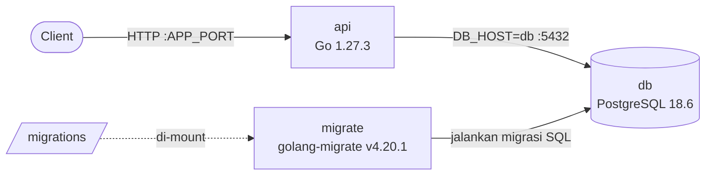

<h1 align="center">Account API</h1>

<p align="center">
  Backend API akun pengguna dengan Go, PostgreSQL, dan migrasi database terversi.<br>
  Seluruh lingkungan berjalan di Docker, tanpa install Go atau PostgreSQL di mesin host.
</p>

<p align="center">
  
  
  
  
  
</p>

---

## Ringkasan

Proyek ini adalah fondasi backend untuk pengelolaan akun, dibangun untuk menunjukkan praktik dasar yang dipakai di proyek sungguhan:

- **Lingkungan yang bisa diulang.** Cukup Docker dan satu file `.env`. Versi Go, PostgreSQL, dan migrator dipatok secara eksplisit.
- **Skema database terkontrol.** Perubahan skema ditulis sebagai file migrasi SQL dan dijalankan dengan `golang-migrate`, bukan diubah manual.
- **Start-up yang berurutan.** API baru berjalan setelah PostgreSQL lolos healthcheck.
- **Kredensial tidak di-hardcode.** Semua nilai sensitif dibaca dari environment, dan `compose.yaml` tidak punya nilai bawaan untuk kredensial database.
- **Container API berjalan sebagai non-root**, sehingga file yang dibuat container tidak dimiliki `root` di WSL2.

## Arsitektur



| Service   | Image                          | Peran                                              |
| --------- | ------------------------------ | -------------------------------------------------- |
| `db`      | `postgres:18.6-alpine3.24`     | Database, dengan healthcheck `pg_isready`          |
| `migrate` | `migrate/migrate:v4.20.1`      | Menjalankan migrasi. Aktif hanya dengan profil `tools` |
| `api`     | `golang:1.27.3-alpine3.24`     | Menjalankan `./cmd/api`, source di-mount dari host |

## Struktur Proyek

```text
.
├── cmd/api/         # entrypoint aplikasi
├── internal/        # kode aplikasi (tidak bisa diimpor dari luar modul)
├── migrations/      # file migrasi SQL untuk golang-migrate
├── compose.yaml     # db, migrate, api
├── .env.example     # template konfigurasi
├── go.mod
└── go.sum
```

## Prasyarat

- Windows dengan **WSL2** (distro apa pun, contoh: Ubuntu)
- **Docker** dengan integrasi WSL2 aktif (Docker Desktop, atau Docker Engine di dalam WSL2)
- Git
```bash
docker pull postgres:16-alpine
docker pull golang:1.25-alpine
docker pull migrate/migrate:v4.17.1
```

Go dan PostgreSQL **tidak perlu** diinstal.

> Simpan repo di filesystem WSL2 (misalnya `~/projects/account-api`), bukan di `/mnt/c/...`. I/O dan bind mount jauh lebih cepat.

## Mulai Cepat

```bash
# 1. Clone
git clone https://github.com/arckotama/account-api.git
cd account-api

# 2. Siapkan konfigurasi, lalu edit nilainya (jangan pakai nilai contoh)
cp .env.example .env

# 3. Jalankan database
docker compose up -d db

# 4. Terapkan migrasi
docker compose --profile tools run --rm migrate up

# 5. Jalankan API
docker compose up api
```

API tersedia di `http://localhost:${APP_PORT}` (bawaan template: `8080`).

## Konfigurasi

Semua konfigurasi dibaca dari `.env`. Salin dari `.env.example`.

| Variabel      | Fungsi                                              |
| ------------- | --------------------------------------------------- |
| `DB_USER`     | User PostgreSQL                                     |
| `DB_PASSWORD` | Password PostgreSQL. **Ganti dengan nilai Anda sendiri** |
| `DB_NAME`     | Nama database                                       |
| `DB_PORT`     | Port database yang dibuka ke host                   |
| `APP_PORT`    | Port API yang dibuka ke host                        |
| `HOST_ID` / `HOST_GID` | UID dan GID user WSL2 (cek dengan `id -u` dan `id -g`) |

File `.env` sudah diabaikan oleh Git. Jangan pernah meng-commit-nya.

## Migrasi Database

Migrasi disimpan di `migrations/` dan dijalankan lewat service `migrate` (profil `tools`, sehingga tidak ikut menyala saat `docker compose up`).

```bash
# Terapkan semua migrasi yang belum dijalankan
docker compose --profile tools run --rm migrate up

# Rollback satu langkah
docker compose --profile tools run --rm migrate down 1

# Lihat versi migrasi saat ini
docker compose --profile tools run --rm migrate version
```

## Endpoint

<!-- ISI: sesuaikan dengan endpoint yang benar-benar ada di internal/ -->

| Method | Path | Deskripsi |
| ------ | ---- | --------- |
| `GET`  | `/`  | _isi_     |

## Perintah Berguna

```bash
docker compose logs -f api        # log API
docker compose ps                 # status service
docker compose down               # hentikan (data tetap ada di volume)
docker compose down -v            # hentikan dan HAPUS data database
```

## Catatan Desain

- **Healthcheck sebelum start.** `api` dan `migrate` memakai `depends_on` dengan `condition: service_healthy`, jadi tidak ada race condition saat database belum siap.
- **Volume PostgreSQL 18.** Volume dipasang ke `/var/lib/postgresql` (bukan `/var/lib/postgresql/data`), sesuai perubahan struktur direktori di PostgreSQL 18.
- **Cache Go persisten.** Volume `gopath` menyimpan modul dan build cache sehingga start berikutnya lebih cepat.
- **Profil `tools`.** Perintah operasional seperti migrasi dipisah dari service utama agar tidak jalan tanpa disengaja.

## Roadmap

- [ ] Dockerfile multi-stage untuk image produksi (saat ini `compose.yaml` ditujukan untuk pengembangan lokal)
- [ ] Pipeline CI (lint, test, build)
- [ ] _tambahkan sesuai rencana Anda_

## Penulis

Dibuat oleh [@arckotama](https://github.com/arckotama) sebagai proyek portofolio.
